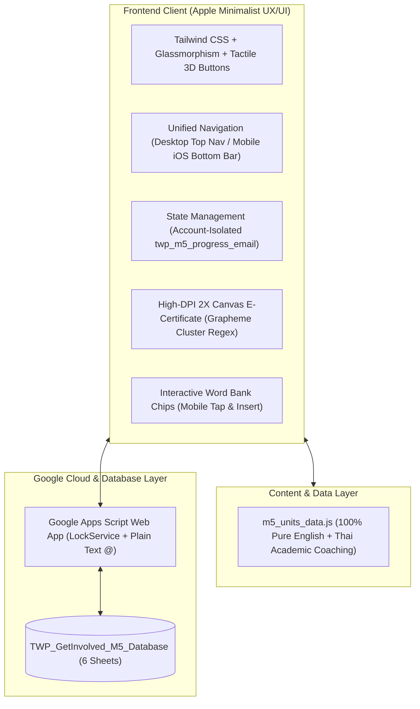

# คู่มือสรุปแนวทางการสร้างและบทเรียนการพัฒนา (Development Retrospective & Next-Level Blueprint)
## โครงการ Get INVOLVED! ม.5 (Academic English Mastery)

เอกสารฉบับนี้จัดทำขึ้นเพื่อรวบรวม **แนวทางการออกแบบเชิงระบบ (System Architecture)**, **สรุปปัญหาข้อผิดพลาดทั้งหมดที่ได้รับการแก้ไขเชิงเทคนิคถาวร (10 Golden Principles)**, **เช็กลิสต์แม่แบบ 5 หมวดหมู่ (Master Checklist)** และ **โครงสร้างเนื้อหาแบบฝึกหัด ม.5 ภาคเรียนที่ 2 (Units 5 - 8)** สำหรับใช้อ้างอิง ตรวจสอบ และขยายผลไปยังระดับชั้นถัดไป (ม.6) ได้อย่างมีประสิทธิภาพสูงสุด

---

## 1. แนวทางการออกแบบเชิงระบบ (Architecture & Standards)

### 1.1 ปรัชญาการออกแบบ UX/UI (Apple Minimalist & Floating Tactile)
1. **โทนสี (Color Palette)**:
   - พื้นหลังหลัก: `#F5F5F7` (Apple Light Gray) สะอาด สว่าง สบายตา
   - การ์ดคอนเทนต์: `#FFFFFF` พร้อมขอบบางคมชัด `border border-black/5` (Hairline Border)
   - สีตัวหนังสือหลัก: `#1D1D1F` (Charcoal Black) คอนทราสต์สูง อ่านสบายตา
   - สีตัวหนังสือรอง: `#6E6E73` (Neutral Slate)
   - สีแอ็กเซนต์: `#0071E3` (Apple Royal Blue)
2. **มิติปุ่มแบบสัมผัสลอยตัว (Tactile 3D Buttons)**:
   - ใช้เงาแบบซ้อน 2 ชั้น (`box-shadow: 0 4px 14px rgba(0,0,0,0.08), 0 1px 2px rgba(0,0,0,0.04)`)
   - Interaction เมื่อ Hover ลอยขึ้น 2px (`translateY(-2px)`) และเมื่อ Active/Click ยุบตัวลง (`translateY(1px) scale(0.985)`)
3. **การนำทางแบบเอกภาพ (Unified Responsive Navigation)**:
   - **Desktop (จอคอมฯ/แท็บเล็ตใหญ่)**: แสดงเป็นแถบ Apple Pill Navigation ด้านบนขวา 4 เมนู: `แผนผังบทเรียน`, `ทำแบบฝึกหัด`, `เกียรติบัตรออนไลน์ (0%)`, `🔒 ระบบคุณครู`
   - **Mobile (จอมือถือ)**: แสดงเป็น **Apple Mobile Bottom Tab Bar** ยึดติดล่างหน้าจอสไตล์ iOS พร้อมรองรับ Safe Area Inset เพื่อให้ใช้นิ้วโป้งกดสลับเมนูทั้ง 4 ได้สะดวก

### 1.2 โครงสร้างเนื้อหา (100% Pure English + Thai Academic Coaching)
- **โจทย์ ตัวเลือก และคำศัพท์**: ต้องเป็น **ภาษาอังกฤษแท้ 100%** ปราศจากคำแปลภาษาไทยแทรกในตัวเลือกเด็ดขาด
- **คำเฉลยและบทวิเคราะห์ (Tutor Insight Coaching)**: แสดงผลเฉพาะหลังจากนักเรียนกดยืนยันตรวจคำตอบแล้วเท่านั้น โดยอธิบายทั้ง:
  - จุดสังเกตในบริบท (Context Clues)
  - หลักไวยากรณ์ (Grammar Rules)
  - เหตุผลที่ข้ออื่นผิด (Distractor Analysis)

### 1.3 ระบบเกียรติบัตรก้าวหน้า (Progressive E-Certificate Engine)
- แสดงผลแบบ Real-time บน `<canvas>` ความละเอียด High-DPI (2400x1700 เรนเดอร์เสมือนขนาด 1200x850):
  - **0 บทเรียน (0%)**: ซ่อนชื่อทั้งหมดเป็นสัญลักษณ์จุดวงกลม `● ● ● ● ● ● ● ●` ล็อคตราประทับทอง
  - **1 บทเรียน (25%)**: ปลดล็อคตัวอักษร 25% แรก
  - **2 บทเรียน (50%)**: ปลดล็อคตัวอักษร 50%
  - **3 บทเรียน (75%)**: ปลดล็อคตัวอักษร 75%
  - **4 บทเรียน (100%)**: แสดงชื่อ-นามสกุลจริงเต็ม 100% พร้อมตราประทับทองคำนูน (Official Gold Seal) และปลดล็อคปุ่มดาวน์โหลดไฟล์ภาพ PNG ความละเอียดสูง

---

## 2. ตารางเจาะลึก 10 ปัญหาที่พบจริง พร้อมวิธีแก้ไขเชิงเทคนิคถาวร

| ลำดับ | ปัญหาที่พบจริง (Real-World Issue) | สาเหตุที่แท้จริง (Root Cause) | วิธีแก้ไขเชิงเทคนิคถาวร (Permanent Solution) | ผลลัพธ์ในระบบ ม.5 |
|:---:|:---|:---|:---|:---|
| **1** | **คำแปลภาษาไทยรั่วไหลในตัวเลือกข้อสอบ** | ข้อมูลดิบจากไฟล์ PDF สรุปคลิปมีคำแปลภาษาไทยปะปนในตัวเลือก | คัดแยกและคลีนตัวเลือกทั้งหมดให้เหลือเฉพาะภาษาอังกฤษ 100% และย้ายคำแปลภาษาไทยไปใส่ไว้ในช่อง `explanation` | ตัวเลือกเป็นภาษาอังกฤษแท้ 100% นักเรียนได้ฝึกอ่านวิเคราะห์จริง |
| **2** | **รหัสผ่านคุณครู (1234) ปรากฏในเมนูนักเรียน** | มีการระบุข้อความกำกับ `ระบบคุณครู (รหัสผ่าน 1234)` ใน Dropdown | ลบข้อความและปุ่มออกจาก Dropdown นักเรียน 100% และแยกไปไว้ในแท็บ "ระบบคุณครู" โดยกดแล้วจะเปิดรหัสผ่าน PIN ให้กรอกโดยไม่มีข้อความใบ้รหัส | รหัสผ่านปลอดภัย 100% นักเรียนไม่เห็นรหัสผ่าน |
| **3** | **ความไม่สอดคล้องกันของการนำทางระหว่างคอมฯ กับมือถือ** | บนมือถือไม่มีแถบเมนูแยก ทำให้ UX ขาดความต่อเนื่อง | สร้าง **Apple Mobile Bottom Tab Bar** 4 แท็บที่สอดคล้องกับ Top Nav บน Desktop พร้อมซิงค์สถานะ Active ทั้งสองส่วนพร้อมกัน | การนำทางลื่นไหล สอดคล้องสมบูรณ์ทุกอุปกรณ์ |
| **4** | **เกียรติบัตรและคะแนนค้างหลัง Logout** | ไม่ได้แยกระหว่างบัญชีผู้ใช้ใน LocalStorage และไม่ได้ล้าง State ในหน้าเว็บ | แยก LocalStorage รายบุคคลด้วยอีเมล (`twp_m5_progress_<email>`) และเมื่อกด Logout ให้คืนค่า State เป็น Unauthenticated รีเซ็ตเป็น 0% ทันที | ป้องกันข้อมูลค้างข้ามบัญชี 100% |
| **5** | **กดตรวจข้อสอบก่อนทำเสร็จและสปอยล์เฉลยข้อที่ยังไม่ทำ** | ระบบตรวจคำตอบของทุกข้อในส่วนนั้นโดยไม่เช็คสถานะการตอบ | ติดตั้ง **Early Exit Confirmation**: ตรวจและคิดคะแนนเฉพาะข้อที่ทำแล้ว ส่วนข้อที่เว้นไว้จะไม่เฉลยและขึ้นสถานะรอทำ | ยึดตามมาตรฐานการสอบจริง ไม่สปอยล์เฉลยข้อที่ยังไม่ได้ทำ |
| **6** | **ปัญหาสระลอยและวรรณยุกต์ขาดบนเกียรติบัตร** | การตัดสตริงภาษาไทยด้วย `slice()` หรือ `Array.from()` ทำให้สระบน/ล่างและวรรณยุกต์หลุดออกจากพยัญชนะต้น | ใช้ Unicode Property Escape เพื่อจับกลุ่มคลัสเตอร์อักษรภาษาไทย: `/\P{M}\p{M}*/gu` | ตัวอักษรภาษาไทยตัดคำได้เรียบเนียน ไม่เกิดปัญหาสระลอยหรือวรรณยุกต์ขาด |
| **7** | **หน้าจอมือถือ Header ล้น แถบล่างบังปุ่ม และ Modal หลุดจอ** | 1. Header บนมือถือยาวเกินไป 2. ปุ่มด้านล่างถูก Bottom Nav ทับ 3. Modal ไม่จำกัดความสูง | 1. Responsive Header พร้อม truncate ข้อความ 2. เพิ่ม `pb-24 lg:pb-8` ใน `<main>` ป้องกันการถูกบัง 3. เพิ่ม `max-h-[90vh] overflow-y-auto` ให้กับ Pop-up Modal ทุกบาน 4. แถบเลือก Part รองรับ Horizontal Scroll | ใช้งานบนหน้าจอสมาร์ตโฟนได้สมบูรณ์แบบทุกขนาด |
| **8** | **Google Sheets แปลงรหัสนักเรียนเป็นตัวเลข/วันที่อัตโนมัติ** | Google Sheets มีฟีเจอร์ Auto-format ข้อความที่คล้ายตัวเลขหรือวันที่ | ใน `Code.gs` ให้ใช้คำสั่ง `sheet.getRange(...).setNumberFormat("@")` ก่อนการบันทึกข้อมูล เพื่อบังคับให้เป็น Plain Text เสมอ | รหัสนักเรียน เช่น STD-M5-001 และคะแนนคงรูปถูกต้อง 100% |
| **9** | **ปัญหา Path ภาษาไทยและการเปิดไฟล์บน Localhost / GitHub Pages** | ชื่อโฟลเดอร์มีภาษาไทยและช่องว่าง ทำให้ URL Encoding ในระบบ Markdown เสียหาย | จัดวางไฟล์หลักเป็น `index.html` พร้อม Relative Path และเพิ่ม `.nojekyll` รองรับ GitHub Pages โดยตรง | ลิงก์และระบบเปิดได้ราบรื่น 100% ไม่เกิดปัญหา Error 404 |
| **10** | **สิทธิ์การ Push ขึ้น GitHub ผ่าน Sandbox** | Terminal Sandbox ค่าเริ่มต้นบล็อกการเชื่อมต่อเน็ตเวิร์กออกภายนอก | รันคำสั่ง Git Push โดยระบุพารามิเตอร์ `BypassSandbox: true` เพื่อขออนุญาตเชื่อมต่อเน็ตเวิร์กกับ GitHub โดยเฉพาะคำสั่ง Push | อัปเดตขึ้น GitHub สำเร็จอย่างราบรื่น |

---

## 3. เช็กลิสต์แม่แบบ 5 หมวดหมู่ สำหรับเริ่มทำ ม.5 และ ม.6 (Master Checklist)

### 3.1 การเตรียมข้อมูลเนื้อหา (Content & Data Layer)
- [x] สกัดเนื้อหาจาก PDF แยก 4 ยูนิต (Unit 5 - 8 ประจำเทอม 2)
- [x] ตรวจสอบว่าโจทย์ ตัวเลือก และคำศัพท์เป็น **ภาษาอังกฤษแท้ 100%**
- [x] จัดทำคำเฉลยภาษาไทยเชิงวิเคราะห์เจาะลึก (Tutor Insight Coaching) ให้ครบถ้วนทุกข้อ
- [x] ตรวจสอบคีย์คำตอบให้ตรงกับเฉลยต้นฉบับในเอกสารใบงาน ทวพ.

### 3.2 ระบบสิทธิ์และความปลอดภัย (Security & Permissions)
- [x] ซ่อนและป้องกันรหัสผ่านครูผู้สอน (`1234`) **ไม่ให้มีข้อความใบ้รหัสผ่านใน UI หรือ Dropdown เด็ดขาด**
- [x] แยกเมนูของนักเรียนออกจากเมนูครูผู้สอนอย่างชัดเจน
- [x] ติดตั้งระบบล็อค (Lock Dashboard) เพื่อให้ครูกดล็อคหน้าจอได้ทันทีเมื่อใช้งานเสร็จ

### 3.3 การแยกฐานข้อมูลผู้ใช้และความก้าวหน้า (Data Isolation)
- [x] คีย์ LocalStorage ต้องนำหน้าด้วยรหัสนักเรียนหรืออีเมล เช่น `twp_m5_progress_<email>`
- [x] เมื่อกด **Logout**:
  - ต้องเคลียร์สถานะเป็น Unauthenticated
  - รีเซ็ตตัวเลขความก้าวหน้าบน Navbar และเกียรติบัตรเป็น **0%** ทันที
  - ล็อคการดาวน์โหลดเกียรติบัตรหากยังไม่ได้เข้าสู่ระบบ
- [x] เกียรติบัตรต้องใช้ Regex `/\P{M}\p{M}*/gu` ป้องกันปัญหาสระลอยในการสุ่ม/ตัดคำภาษาไทย

### 3.4 ความสมบูรณ์ของ UX/UI บนมือถือ (Mobile Responsiveness)
- [x] ติดตั้ง **Apple Mobile Bottom Tab Bar** ที่ตรงกับ Top Nav บน Desktop
- [x] ตรวจสอบระยะเว้นวรรคด้านล่าง (`pb-24 lg:pb-8`) ไม่ให้แท็บบาร์บังปุ่มทำแบบฝึกหัด
- [x] แถบเลือก Part 1/2/3/4 ต้องเลื่อนในแนวนอนได้ (`overflow-x-auto no-scrollbar`)
- [x] หน้าต่าง Pop-up Modal ทุกบานต้องมี `max-h-[90vh] overflow-y-auto`
- [x] ปุ่ม "ตรวจคำตอบ" ต้องจัดวางให้กดง่ายเต็มความกว้างหน้าจอเมื่ออยู่บนมือถือ
- [x] เพิ่ม **Word Bank Chips** แตะเพื่อนำคำศัพท์ใส่ในช่องว่างได้สะดวกรวดเร็วบนจอมือถือ

### 3.5 การเชื่อมต่อระบบคลาวด์และ Google Sheets (Backend Integration)
- [x] สร้างสคริปต์ `Code.gs` สำหรับฐานข้อมูล `TWP_GetInvolved_M5_Database` ให้มีครบ 6 แผ่นงาน:
  1. `Students_DB` (ทะเบียนนักเรียน ม.5)
  2. `Name_base` (ดัชนี Auto-lookup)
  3. `Login_Logs` (ประวัติการเข้าใช้งาน)
  4. `Scores_Log` (บันทึกคะแนนละเอียด)
  5. `Certificates` (ทะเบียนเกียรติบัตร)
  6. `Teacher_Config` (การตั้งค่าระบบ)
- [x] ฝัง `LockService` และ `setNumberFormat("@")` ป้องกันข้อมูลเพี้ยน
- [x] ติดตั้งระบบ Ping และฟังก์ชันซิงค์คะแนนอัตโนมัติ

---

## 4. โครงสร้างเนื้อหาแบบฝึกหัด ม.5 ภาคเรียนที่ 2 (Units 5 - 8)

| หน่วยการเรียนรู้ | หัวข้อหลัก (Topics) | ส่วนย่อย (Sections) | จำนวนข้อ | สาระสำคัญทางวิชาการ |
|:---|:---|:---|:---:|:---|
| **Unit 5** | **Environment & Video Content** | Part 1: Video Content Comprehension Part 2: Environment Vocabulary Part 3: Passive Voice & Rules Part 4: Speaking Phrases | 18 ข้อ | - Park Clean, Food Waste, Eco-friendly Phones - Deforestation, Landfill, Pesticides, Solar Power - Present Simple Passive, let / make / be allowed to - "The cheaper, the better!", "as good as" |
| **Unit 6** | **Crimes & Consequences** | Part 1: Video Content Comprehension Part 2: Crime & Cyber-crime Vocab Part 3: Conditionals & Unless Part 4: Expressing Regrets | 16 ข้อ | - Stolen Bike, Classroom Rules, Crime Fiction - Detective, Suspect, Witness, Phishing, Cyberbullying - First Conditional (If + Present, will + V), Unless - Past Regret (I wish / If only + had + V.3) |
| **Unit 7** | **Time Flies!** | Part 1: Video Content Comprehension Part 2: Reporting Verbs Part 3: Reported Statements Part 4: Reported Questions | 15 ข้อ | - Bullet Journal, Queen Cleopatra, Sci-Fi Movies - Admitted, Recommended, Complained, Promised, Insisted - Tense Shift (Present Continuous → Past Continuous) - Wh-question word order & If/Whether |
| **Unit 8** | **Sports** | Part 1: Video Content Comprehension Part 2: Sports Vocab & Benefits Part 3: Gerunds & Infinitives Part 4: Quantifiers | 18 ข้อ | - Football Match, Sam Kerr, South Pole Expedition - Accuracy, Stamina, Beat, Train, Score, Fitness - Decide to, Start playing, After competing, Give up playing - Too many vs Too much, Enough, A few vs A little |
| **รวมทั้งสิ้น** | **4 หน่วยการเรียนรู้** | **16 ส่วนย่อย** | **67 ข้อ** | **แบบฝึกหัดภาษาอังกฤษ ม.5 มาตรฐานสากล ทวพ.** |
